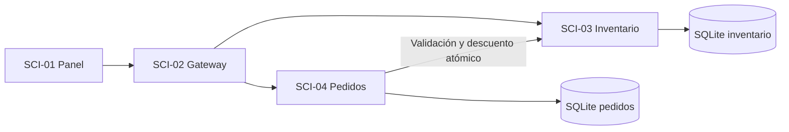

# Sistema Distribuido de Gestión de Supermercado — ISWD922 (Grupo 06)

Aplicación académica con inventario persistente, pedidos validados contra existencias y un panel administrativo. Los cuatro elementos de configuración se gestionan en el monorepo `iswd922-grupo06-supermercado-distribuido`: https://github.com/Jairo-lo/iswd922-grupo06-supermercado-distribuido.git. El incremento técnico `5b2b164` está publicado en `main`; la rama técnica es `feature/iswd922-supermercado`. Consulte la conciliación RN/RF en la matriz de trazabilidad.

## Ejecución local

Requiere Node.js 22.15 o superior y npm. Desde esta carpeta:

```sh
npm ci
npm run build:all
npm start
```

Panel: http://localhost:5173 · Gateway: http://localhost:4000. Para desarrollo con recarga: `npm run dev`. `npm run install:all` instala los cuatro workspaces. Los procesos se detienen con Ctrl+C. Las bases locales quedan en cada servicio; no se versionan. Al iniciar una base vacía se crean seis productos de demostración. La base heredada de inventario conserva los siete productos existentes y obtiene SKU `LEG-<id>`, mínimos y máximos por defecto; no se reemplaza por la semilla.

## Docker

Las variantes local y Docker comparten el puerto 4000; detenga una antes de iniciar la otra.

```sh
docker compose config --quiet
docker compose up --build --wait
docker compose down
```

Panel: http://localhost:8080 · Gateway: http://localhost:4000. La red es `supermercado-net`; los dos volúmenes SQLite persisten entre reinicios. Inventario y pedidos solo se exponen a la red interna. Las bases Docker comienzan vacías, separadas de las locales. Para acceso desde otra máquina, cambie el argumento de compilación `VITE_API_GATEWAY_URL` y los orígenes CORS y reconstruya el panel.

## Inicio desde Git Bash en Windows

Abra Docker Desktop y espere a que el motor esté disponible. Dentro de la carpeta del proyecto:

```bash
# Compatible con la instalación de Docker Desktop por usuario.
export PATH="$PATH:$(cygpath -u "$LOCALAPPDATA")/Programs/DockerDesktop/resources/bin"
docker version
docker compose up --build -d --wait
docker compose ps
```

Abra http://localhost:8080. Para detenerlo conservando los datos: `docker compose down`. Para consultar el estado distribuido: `curl http://localhost:4000/health`. No hace falta ejecutar npm en Windows para usar la variante Docker. Las imágenes se compilan con el lock del repositorio; la primera ejecución requiere conexión para descargar dependencias.

## Verificación reproducible

```sh
npm run build:all
npm run lint
npm run test:acceptance
npx playwright install chromium
npm run test:ui
node scripts/consolidate-evidence.mjs
```

`npm run verify` ejecuta toda la secuencia una vez instalado Chromium. Las pruebas arrancan procesos propios con puertos libres y bases aisladas en `.test-runs/`; conservan logs para auditoría y detienen los procesos al finalizar. No modifican las bases de uso local. Las evidencias técnicas están en [docs/evidencias](docs/evidencias). El consolidado rechaza resultados de otra versión del código mediante una huella SHA-256.

MET-CAL-01 mide los criterios de los paquetes efectivamente evaluados; el reporte de aceptación por API cubre PT-01 a PT-03 y el reporte de navegador cubre PT-04. MET-CAL-02 permanece N/D hasta que QA concilie un registro completo de defectos; cero fallos de una batería no demuestra cero defectos graves abiertos. Las pruebas automatizadas tampoco acreditan revisión cruzada ni aceptación humana. La ejecución de Docker se registra por separado de las pruebas locales.

## Arquitectura y responsabilidades

| SCI | Paquete EDT | Componente | Tecnología | Puerto | Responsable de ejecución |
| --- | --- | --- | --- | --- | --- |
| SCI-01 | PT-04 | Panel administrativo | React, TypeScript, Vite | 5173 / Docker 8080 | Anael Molina |
| SCI-02 | PT-03 | API Gateway | Express, Axios, Morgan | 4000 | Jairo Quispe con Anael Molina |
| SCI-03 | PT-01 | Inventario | Express, Sequelize, SQLite | 3000 | Anael Molina |
| SCI-04 | PT-02 | Pedidos | Express, Axios, Sequelize, SQLite | 3001 | Anael Molina |



| Integrante | Rol | RACI principal |
| --- | --- | --- |
| Marcelo Torres | Director / Scrum Master | A interno; R planificación, capacidad y SCCB |
| Harryson Montesdeoca | Requisitos / QA | R requisitos, RTM, SQAP, FCA/PCA y defectos |
| Jairo Quispe | Arquitecto / SCM | R contratos, configuración e integración |
| Anael Molina | Desarrollo | R PT-01, PT-02, PT-04; apoyo en PT-03 y correcciones |

La aprobación exige revisión de un integrante distinto del autor. Ningún documento generado acredita aprobaciones del equipo.

## Contratos y datos

- `GET /health` en los tres servicios. El Gateway responde 503 si una dependencia cae.
- `GET/POST /api/productos`, `GET/PUT/DELETE /api/productos/:id`.
- `PATCH /api/productos/:id/descontar-stock` y `reponer-stock`: cuerpo `{ "cantidad": 2, "operacionId": "op-unica-opcional" }`. El descuento usa una transacción SQLite con UPDATE condicionado a disponibilidad; devuelve 409 sin alterar stock si falta disponibilidad.
- `GET/POST /api/pedidos`, `GET /api/pedidos/:id`, `GET /api/pedidos/indicadores-ods`. POST recibe `{ "clienteNombre": "Cliente", "productoId": 1, "cantidadSolicitada": 2 }`. Confirmación: 201; rechazo de negocio persistido: 200; integración pendiente: 503.
- `GET /api/dashboard/resumen`, `GET /api/gateway/trazabilidad`.
- Compatibilidad: `/api/products` conserva la lista como arreglo y los campos name/price/stock/category; `/api/orders` acepta productId/quantity. El contrato principal usa nombres en español.
- Pedido: cabecera opcional `X-Idempotency-Key` (1–80 caracteres alfanuméricos, guion o guion bajo). Repetir clave y cuerpo devuelve el mismo pedido. Cambiar el cuerpo con la misma clave produce 409.
- La reserva de stock persiste su resultado y el intento de pedido se guarda antes de descontar. Los errores ambiguos permanecen como ERROR_INTEGRACION y se reconcilian al reiniciar o cada 30 segundos. Un intento pendiente puede confirmarse posteriormente cuando inventario vuelve; consultar su estado antes de crear otro pedido. La protección frente a reintentos del cliente requiere reutilizar la misma clave.
- Filtros: `?estado=CONFIRMADO`, `?viable=true|false`. Sin pedidos, porcentajes y tiempos son null (N/D).

El panel consume exclusivamente el Gateway y envía `X-Operador-Rol`. ADMIN y OPERADOR escriben; AUDITOR_SQA solo lee. Lecturas sin rol usan ADMIN; escrituras sin rol requieren una clave configurada en `GATEWAY_ACCESS_KEY` y enviada como `X-Access-Key`. Los roles se declaran en una cabecera para demostración académica: no constituyen autenticación de identidad. El despliegue está limitado a localhost. La bitácora mantiene solo las últimas 50 operaciones en memoria; las trazas de Morgan incluyen X-Trace-ID y los pedidos conservan su traza.

## Indicadores y alcance

IND-ODS-01 es el porcentaje de pedidos realmente contrastados con existencias; los errores de integración no se cuentan como validaciones. IND-ODS-02 cuenta productos actualmente agotados, críticos o excedidos; es un indicador de detección y no acredita anticipación temporal ni reducción de desperdicio. IND-ODS-03 es el tiempo promedio de procesamiento del pedido, asociado a digitalización (ODS 8, meta 8.2). Los objetivos se alinean a ODS 12, meta 12.3 y ODS 8, metas 8.2 y 8.3. No se implementan pagos reales, facturación fiscal ni reparto.

## Gestión y evidencias

La [entrega documental del 24/11/2026](docs/entrega-documental-20261124/00_LEER_PRIMERO.txt) contiene los originales editables consolidados, sus PDF, la equivalencia RN/RF y el inventario con SHA-256. Sustituye como referencia documental vigente a los anexos históricos de la raíz; conserva el commit `5b2b164` como identidad del producto técnico evaluado. Las aprobaciones humanas siguen pendientes.

- [Alcance y resumen de Charter](docs/01_Project_Charter_Resumen.md)
- [Matriz de trazabilidad](docs/02_Matriz_Trazabilidad_Requisitos_RTM.md)
- [Configuración y líneas base](docs/03_Gestion_Configuracion_SCM_Lineas_Base.md)
- [Calidad y métricas PRJ-013](docs/04_Plan_Calidad_SQAP_y_Metricas_PRJ013.md)
- [Origen y límites de los anexos](docs/05_Fuentes_y_Registro_Migracion.md)
- [Estado de verificación](docs/06_Estado_Verificacion.md)
- [Colección Postman](tests/postman/GRUPO06_Supermercado_SQA_Collection.json)

Los anexos DOCX/XLSX/ZIP originales se conservan en la raíz sin modificar. La copia del estado de trabajo anterior está en `.local-backup/estado-previo-2026-11-15.zip`, excluida de Git. Se retiraron de la estructura activa los directorios antiguos y los node_modules que estaban versionados. El único archivo lock autoritativo es `package-lock.json` en la raíz. Los overrides de uuid y minimatch corrigen alertas de dependencias indirectas; sus versiones efectivas quedan fijadas en ese lock y se validan con la batería técnica. El flujo CI reproduce la verificación y contiene un trabajo independiente de Docker.
